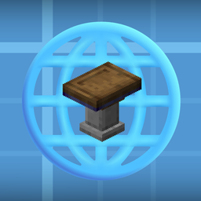

# 机械动力：蓝图互联网（blueprintnet）

在 Create 图纸桌里直连蓝图站。

**中文** ｜ [English](#english)

> 其他平台版本：[`README-CurseForge.md`](README-CurseForge.md)（模组平台，英文优先）·[`README-mcmod.txt`](README-mcmod.txt)（MC百科，纯中文纯文本）

给 Minecraft **1.21.1 + NeoForge 21.1.265 + Create 6.0.10** 用的小模组：在机械动力的**图纸桌（Schematic Table）**面板上方加三个按钮，
点开就能浏览蓝图站、翻页、搜关键词、看详情，把蓝图**下载到 `schematics/`**；非 Create 格式的会自动转成结构 `.nbt`，
大蓝图还能按尺寸**切块**。

```
┌──────────────[CMS][M][处]┐   ← 三个入口（图纸桌面板右上角上一行）
│  CMS 蓝图库  ── creativemechanicserver.com（HTML 站，要 CSRF）
│  MCS 蓝图站  ── mcschematic.top（公开 JSON API，匿名可读）
│  蓝图处理    ── schematics/ 里的文件：转 nbt / 分割
```

> 只做「人点一下、存一个文件」，没有批量抓取、没有后台轮询。

---

## 1. 构建方式：手工 javac + jar

本项目**没有使用 Gradle**，而是用 `javac` + `jar` 手工打包，classpath 直接从 Minecraft 实例的
版本 json 与 `libraries/` 拼出来。

起因是最初的开发环境里 `services.gradle.org` 与 `maven.neoforged.net` 的 TLS 握手通不过
（`curl (35)`），NeoGradle / ModDevGradle 那套 MDK 流程走不通。

> **克隆前请注意**：这样构建需要本机有一份完整的 Minecraft + NeoForge/Forge 实例，
> 并能读到它的 `versions/<版本>/<版本>.json` 和 `libraries/`。
> `build.ps1` 顶部的 `$McDir`、`build1201.ps1` 顶部的 `$modsDir` / `$verJson` / `$libsRoot`
> 默认指向作者本机目录，**你需要按自己的实例改**。
> 只想要能用的模组，用 Releases 里的 jar；想要 `./gradlew build`，本仓库暂不提供。

两个坑（改脚本时别踩）：

| 坑 | 现象 | 处理 |
| --- | --- | --- |
| 文件编码 | PowerShell 5.1 按 GBK 读 `.ps1`，中文注释被吞、报「意外的标记 `)`」 | 脚本必须存成 **UTF-8 with BOM**（被编辑器改成无 BOM 后要重新加回来） |
| 中文路径 | `javac: 无效标志: ?C:\...\dsh文件夹\...` | 所有传给 `javac`/`jar` 的路径用**相对路径**，先 `Push-Location` 到工程根；`@sources.txt` 用 ASCII 写 |

---

## 2. 构建 / 安装

```powershell
cd path\to\cms-blueprints

.\build.ps1                    # 编译 + 打包 + 装进实例 mods\
.\build.ps1 -NoInstall         # 只编译打包
.\build.ps1 -McsTest           # 联网自测：MCS 搜索→详情→下载→转 nbt→分割，外加 CMS 冒烟
.\build.ps1 -ConvertTest       # 离线自测：转换 / 分割的往返一致性
.\build.ps1 -CoverTest         # 离线自测：WebP 解码器注册与真封面解码
.\build.ps1 -Smoke             # 离线冒烟：CMS 的 CSRF→搜索→详情→下载
```

产物：`build\blueprintnet-0.1.0.jar`（约 713 KB / 441 class，内含 6 个 twelvemonkeys WebP 解码器 jar 与 256×256 图标），
安装目标 `$McDir\versions\<实例>\mods\`（安装前先删旧的 `cmsblueprints-*.jar` / `blueprintnet-*.jar`）。

**只想用、不想编**：`dist/` 里放着预编译好的两个 jar，直接丢进 `mods/` 即可。

| 文件 | 用于 |
|---|---|
| `dist\blueprintnet-1.21.1-0.1.0.jar` | 1.21.1 + NeoForge 21.1.265 + Create 6.0.10 |
| `dist\blueprintnet-1.20.1-0.1.0.jar` | 1.20.1 + Forge 47.4.28 + Create 6.0.8 |

最近一次 `-McsTest` 结果：

```
== MCS ==
  搜索：20 条 / 21 页 / 总计 408
    首条：精密构件机（传送带版）｜作者 影歌歌｜格式 create｜下载 216
  可转换样本：终末地：协议核心.litematic｜格式 litematica
  详情：尺寸 5×3×2｜文件 1｜材料 11｜注释 79 字
  封面：200363 B（900×900）
  下载：精密构件机（传送带版）.nbt（1799 B）
  下载（待转换）：终末地：协议核心.litematic（49689 B）
  转换：已生成 终末地：协议核心.nbt（166.0 KB，99×224×105）
    读回：size=[99,224,105] palette=180 blocks=59472
  网格：计划 9 份（体积覆盖 ✓，越界 无），落盘 9 份可读 ✓，非空气 150/150 ✓
== CMS ==
  搜索：20 条 / 51 页 / 总计 1009
  详情：尺寸 5✖5✖5｜文件 3｜材料 60
```

---

## 3. 游戏内怎么用

**入口 1（推荐）**：放一个图纸桌，右键打开界面 → 面板右上角上一行三个按钮：
`CMS`（CMS 蓝图库）/ `M`（MCS 蓝图站）/ `处`（蓝图处理）。

**入口 2（旁路）**：任何界面按 `T` 输入 `/cms`、`/mcs`、`/bptool` 直接开对应界面。

### 列表页

| 操作 | 说明 |
| --- | --- |
| 点行 | 选中；再点同一行进入详情 |
| `↑` `↓` | 移动选中项 |
| `Enter` | 打开选中项详情 |
| 滚轮 | 上一页 / 下一页（真的发请求，两个站点都是分页接口） |
| 搜索框 + 「搜索」 | 关键词查询，回车也生效（MCS 留空 = 热门） |
| 排序按钮 | CMS：下载量 / 最新；MCS：热门 / 最新 |
| 「上一页 / 下一页」 | 站点页码，每页 20 条 |
| `ESC` | 关窗 |

### 详情页

左上是预览框，右上标题/作者/下载量/尺寸/应力/版本和注释，下方是**整幅宽**的「文件 / 材料」双 tab。

预览框三种来源，点右上角的小角标循环切换：

| 角标 | 来源 | 说明 |
| --- | --- | --- |
| `图` | 站点封面图 | CMS 是 WebP、MCS 是 PNG，走自带解码器；**点击预览框全屏放大，滚轮缩放** |
| `3D` | 塞博护目镜（CyberGoggles） | 拖拽换视角、滚轮缩放；装上就该模组才可用 |
| `俯` | 内置俯视投影 | 自带渲染，不依赖外部模组 |

底部按钮：

- **下载**（文件行右侧）—— 下载到 `schematics/`；不是 Create 格式的（`.litematic` / `.schem`）**下完立刻自动转成 `.nbt`**，原始文件保留；
- **转nbt** —— 把当前选中、且已经下载到本地的文件转成结构 `.nbt`；
- **分割** —— 打开分割设置页：选切割方式（竖直 / 水平 / 网格）与数量，产物写进 `<名字>/` 子目录（对任意支持的格式都可用）；
- **返回列表 / 关闭**。

文件名规则：CMS 用 `<帖子ID>_<蓝图名>.<原扩展名>`，MCS 用标题（去掉自带扩展名）+ 按 `sourceFormat` 定扩展名；重名自动加 `-2`。

### 蓝图处理页（`处` / `/bptool`）

列出 `schematics/` 里所有 `.nbt` / `.litematic` / `.schem` / `.schematic`，选中后可以：

- **转nbt** —— 只做「转进机械动力」这一个方向；
- **分割** —— 打开分割设置页（见下）；
- **刷新** —— 重新读目录（下载/转换完想看新文件时点一下）。

### 分割设置页

切割方式与数量对齐 McSTools：

| 方式 | 语义 | 数量 |
| --- | --- | --- |
| 竖直（X） | 沿 X 竖着切 N 份，每份保留全高全深 | 2 / 3 / 4 / 5 / 6 / 8 / 10 预设，或用 `-` `+` 任意自选 |
| 水平（Y） | 沿 Y 水平切 N 层，每份保留全宽全深 | 同上（想切几层就几层） |
| 网格（XZ） | 在 XZ 平面切 k×k，总量 k² | 2×2 / 3×3 / 4×4 / 5×5（放不下的档位自动禁用） |

- 分段规则：`每份 = 总长 / N`，余数全部并入**最后一份**；
- 产物：写进 `<名字>/` 子目录，文件名 `<名字>_x1.nbt`、`<名字>_y1.nbt`、`<名字>_1x1.nbt`；
- 目录已存在且非空 → 自动改用 `<名字>-2/`，不覆盖、也不混着放；
- 预览行会先算好「将生成几份、每份 ≤ a×b×c」，点「分割」才真正落盘。

> 方向只有一个：**别的格式 → Create 结构 nbt**。把 Create 的 `.nbt` 转去 Litematica / WorldEdit 不做。

---

## 4. 配置

首次启动会生成 `config/blueprintnet.properties`（旧名 `cms-blueprints.properties` 存在时会自动迁移）：

```properties
site=https://www.creativemechanicserver.com
userAgent=Mozilla/5.0 (Windows NT 10.0; Win64; x64) ... Chrome/156.0.0.0 Safari/537.36
proxy=
timeoutSeconds=30
requestIntervalMs=300
```

- `proxy`：`host:port`。留空 = 先看环境变量 `HTTPS_PROXY`/`https_proxy`/`HTTP_PROXY`/`http_proxy`，再退回系统默认。
  **这台机器的 `https_proxy=http://127.0.0.1:7890` 已被识别**（日志里有 `使用代理 127.0.0.1:7890`）。
- `site` 只管 CMS；MCS 的 API 域名写死在 `McsSite.BASE`（`https://mcschematic.top/api/v1`）。
- `userAgent`：CMS 前面是 Cloudflare。默认用普通 Chrome UA；真被挑战就改成浏览器 `F12 → Network` 里那串。
- `requestIntervalMs`：CMS 两次请求的最小间隔，防自己把站点打太狠。

---

## 5. 代码结构

```
cms-blueprints/
├─ LICENSE / THIRD_PARTY_NOTICES.md 协议与第三方声明
├─ build.ps1                        1.21.1 NeoForge 构建脚本（javac + jar，若干 -XxxTest 开关）
├─ build1201.ps1                    1.20.1 Forge 构建脚本（编译 + 重映射 + 打包 + 安装）
├─ lib/webp/*.jar                   twelvemonkeys 3.10.1 纯 Java WebP 解码器（打包时合进 jar）
├─ tools/                           1.21.1 离线自测
│  ├─ SmokeTest.java                CMS 离线冒烟
│  ├─ ConvertTest.java              转换/分割往返一致性
│  ├─ CoverTest.java                WebP 解码器
│  └─ McsTest.java                  MCS 联网全链路
└─ src/main/
   ├─ java/dev/cmsbp/
   │  ├─ CmsBlueprints.java         @Mod 入口，日志
   │  ├─ CmsConfig.java             properties 配置
   │  ├─ CreateBridge.java          Create 侧桥接：目录/保存/找文件/载入/刷新/面板原点反射
   │  ├─ net/
   │  │  ├─ Site.java               站点抽象（tag/title/sorts/search/detail/cover/download + 数据 record）
   │  │  ├─ CmsSite.java            CMS 实现：包装 CmsClient + HtmlParser
   │  │  ├─ CmsClient.java          HttpClient 会话：CSRF、搜索、详情、下载
   │  │  ├─ HtmlParser.java         CMS HTML 正则解析（照抄 cms_tool.py 的规则）
   │  │  ├─ McsSite.java            MCS 实现：/blueprints 分页、详情、preview、版本下载
   │  │  └─ Net.java                单线程 daemon executor
   │  ├─ schem/
   │  │  ├─ Schematic.java          中立模型（palette + 方块数组 + 方块实体/实体 + split）
   │  │  ├─ Litematica.java         .litematic 读取（分区域、位宽解码）
   │  │  ├─ WorldEdit.java          .schem / .schematic 读取
   │  │  └─ Convert.java            入口：toNbt / split，产物落 schematics 目录
   │  └─ ui/
   │     ├─ BrowseScreen.java       列表 + 详情（站点无关）
   │     ├─ ToolScreen.java         蓝图处理（转 nbt / 分割）
   │     ├─ CreateUi.java           Create 风格绘制 + AllIcons 反射
   │     ├─ CoverImage.java         WebP/PNG 封面下载→解码→DynamicTexture 缓存
   │     ├─ SimplePreview.java      内置俯视投影渲染
   │     ├─ PreviewBridge.java      塞博护目镜桥（反射，缺模组时静默降级）
   │     └─ TableButtonHook.java    图纸桌三个入口按钮（自绘 + 自命中，不用 Mixin）
   └─ resources/
      ├─ META-INF/neoforge.mods.toml
      └─ assets/blueprintnet/icon.png   256×256 模组图标
```

1.20.1 版是同一套代码的另一份源码树（包名相同，多出蓝图桌扩展）：

```
cms-blueprints/
├─ tools1201/                       重映射管线
│  ├─ MakeMappings.py               proguard + tsrg2 → 4 份映射
│  ├─ TsrgRemap.java                官方 client jar → 可读名（javac 用）
│  ├─ Reobf.java                    编译产物 → SRG（沿继承链传播）
│  ├─ CheckRemap.py                 扫描漏重映射的成员引用
│  └─ CheckClasses.py               扫描「引用了但运行时不存在」的类
└─ src1201/
   ├─ java/dev/cmsbp/               net / schem 与 1.21.1 版一致
   │  └─ ui/
   │     ├─ BrowseScreen.java       同上，但无 `GOGGLES` 态
   │     ├─ ToolScreen.java         同上
   │     ├─ CreateUi.java           Create 风格绘制 + AllIcons 反射
   │     ├─ CoverImage.java         WebP/PNG 封面→DynamicTexture
   │     ├─ SimplePreview.java      内置俯视投影渲染
   │     ├─ TableButtonHook.java    图纸桌三个入口按钮
   │     ├─ TablePickerExt.java     蓝图桌扩展：文件夹下拉 + 上传名压平（第 8 节）
   │     ├─ SchematicFolders.java   schematics 子目录扫描与选择状态
   │     └─ SchematicPreviewPanel.java  真 GL 3D 预览（SchematicRenderer）
   └─ resources/                    mods.toml（Forge）+ 图标
```

### 为什么按钮不用 Mixin

`Screen.addRenderableWidget` 是 `protected`，`Screen.renderables` 是 `private`，外部包塞不进真正的 widget。
所以按钮走「**自己画 + 自己命中测试**」：`ScreenEvent.Render.Post` 画，`ScreenEvent.MouseButtonPressed.Pre` 判定并 `setCanceled(true)`。

代价：按钮不在 Tab 焦点链里，键盘选不到它（鼠标完全正常）。换来的是**零 Mixin**、不看 Create 的私有字段。

### 面板坐标

`schedule.png` 是 256×256 图集，面板主体只占 `(13,0)-(238,219)`，所以 `CreateUi` 只 blit 226×220 这一块
（`TEX_X=13, TEX_Y=0, W=226, H=220`），内容右缘统一 `x+218`。

---

## 6. 已知限制 / 排错

- **加载依赖 Create 内部 API**（`CreateClient.SCHEMATIC_SENDER`、`CreatePaths.SCHEMATICS_DIR`、`AllGuiTextures.SCHEMATIC_SLOT`），已锁 6.0.10；Create 大版本变了要重编。
- 入口按钮只对 `SchematicTableScreen` 生效。
- `3D` 预览：**1.20.1 版内置**（见第 8 节）；**1.21.1 版需要装 CyberGoggles**，`PreviewBridge` 反射探测，缺它时自动跳过该档。
- 转换只支持 **`.litematic` / `.schem`（Sponge v1/v2/v3）→ `.nbt`**；`.schematic`（MCEdit 数字 id）会明确报错；分割对四种格式都可用，产物全是 `.nbt`。
- 游戏内 TLS 走 JDK 自己的 `HttpClient`（不是系统 schannel），curl 的 `CRYPT_E_REVOCATION_OFFLINE` 不会出现；公司网做 TLS 拦截时要在 `config` 里给代理。
- 日志：`<实例目录>\logs\latest.log`，搜 `blueprintnet`：
  `cms-blueprints 0.1.0 已加载；配置 <路径>；蓝图目录 ...\schematics`
- 界面里的错误写在面板底部状态行，网络异常截 90 字显示。

---

## 7. 更新记录

- **0.1.0（本次）**
  - 模组标识从 `cmsblueprints` 改为 **`blueprintnet`**，显示名「机械动力：蓝图互联网」；配置文件随之改名
    `config/blueprintnet.properties`（旧的 `cms-blueprints.properties` 首次启动会自动复制迁移）。
  - 修 `.litematic` 转换的**坐标映射错误**：原先把区域下标 0 当成 `Position` 那一格，而 Litematica 实际按
    `posMinRel = getMinCorner(Position, Position+Size-1)` 打散（`LitematicaSchematic.placeBlocksToWorld`）。
    当区域的 `Size` 有负数（站点下载的 `.litematic` 很常见，如 `Size(36,-153,-35)`）时，整个蓝图会在
    该轴上镜像，而方块状态属性是照抄的 → 表现出来就是**楼梯、台阶、朝向类方块的朝向全乱**。
  - 新增离线校验 `build.ps1 -OrientCheck`：转 nbt 后逐格比对，并额外统计「原样 / X 镜像 / Z 镜像」
    三种对位的命中率，用来第一时间发现镜像类错误。

- **1.20.1 版补充（本次）**
  - 蓝图桌支持 `schematics/` 子目录：文件选择器旁新增文件夹按钮与目录下拉（见第 8 节）。
  - 蓝图桌内置 3D 预览：用 Create 自己的 `SchematicRenderer` 真 GL 渲染，可拖拽旋转、滚轮缩放。
  - 分割支持「竖直 / 水平 / 网格 + 数量」，产物自动进同名子目录。

## 8. 1.20.1 Forge 版

同一套源码另有一份 1.20.1 Forge 构建：`src1201/` + `build1201.ps1`，产物
`build\1201\blueprintnet-1.20.1-0.1.0.jar`，安装到 `$modsDir`（脚本顶部变量）。

```powershell
powershell -NoProfile -ExecutionPolicy Bypass -File .\build1201.ps1            # 编译 + 重映射 + 打包 + 安装
powershell -NoProfile -ExecutionPolicy Bypass -File .\build1201.ps1 -CompileOnly  # 只编译
```

### 为什么需要重映射

1.20.1 Forge 运行时用的是**官方类名 + SRG 成员名**（`net/minecraft/client/gui/GuiGraphics.m_280509_`），
不是可读名。所以不能直接编译可读名就丢进 mods —— 覆写的 `render`/`init`/`mouseClicked` 在运行时
根本不会被回调（方法签名对不上）。管线是：

| 步骤 | 工具 | 作用 |
|---|---|---|
| 1 | `tools1201/MakeMappings.py` | 由 Mojang `client_mappings`（proguard）+ Forge `mappings-1.20.1.tsrg`（tsrg2）生成 4 份映射 |
| 2 | `tools1201/TsrgRemap.java` | 把官方 client jar 重映射成可读名（`build/1201/mc-1.20.1-mojmap.jar`），供 javac 用 |
| 3 | `tools1201/Reobf.java` | 编译产物 → SRG（**沿继承链传播**，接口里的 `mouseClicked`→`m_6375_` 这类也能命中） |
| 4 | `build1201.ps1` | 组 classpath、`--release 17`、重映射、打 jar、装实例 |

`javac` 编译可读名时用 `mc-1.20.1-mojmap.jar`，重映射时把 `mc-1.20.1-mojmap.jar`、`forge-client-named.jar`、
`create-1.20.1-6.0.8.jar` 一起作为继承链来源传给 `Reobf`。

### 与 1.21.1 版的差异

- **3D 预览是自己实现的**：1.20.1 的 CyberGoggles 没有预览面板，因此按其 1.21.1 的做法移植了一份
  （见下）。1.21.1 版仍是「检测到 CyberGoggles 才启用 3D」。
- 编译目标是 Java 17（1.21.1 那边是 21）。
- 蓝图处理页的子文件夹导航、分割设置页、CMS/MCS 双站点、转换与分割逻辑完全一致。

### 蓝图桌：子目录可选 + 3D 预览（仅 1.20.1）

两部分都照 **Create Cyber Goggles** 的做法重写（它的协议是 MIT，
声明见 `THIRD_PARTY_NOTICES.md`）。它用 Mixin 注入，本模组没有 Mixin 环境，
改用等价的 Forge 事件：

| 护目镜的注入点 | 本模组的挂载点 |
|---|---|
| `SchematicTableScreen#init` RETURN | `ScreenEvent.Init.Post` |
| `SchematicTableScreen#renderBg` TAIL | `ContainerScreenEvent.Render.Background` |
| `SchematicTableScreen#containerTick` TAIL | 每帧渲染时顺手纠正控件可见性 |
| `ClientSchematicLoader#refresh` HEAD cancel | 不拦截该方法，改为自行维护列表 + 改写确认按钮回调 |

**子目录选择**（`ui/SchematicFolders.java` + `ui/TablePickerExt.java`）：文件夹按钮旁加一个切换按钮，
按下后原文件下拉被替换成目录下拉，列出 `schematics/` 下所有「直接含 `.nbt`」的子目录。

上传时有个必须绕开的限制：服务端 `ServerSchematicLoader` 只创建 `uploaded/<玩家名>/` 一层，
名字里带 `/` 会因父目录不存在而失败。所以点确定时把 `子目录/文件.nbt` 复制成根目录下的
`cms_up_子目录_文件.nbt`，再交给 Create 上传，5 分钟后自动清理。

**3D 预览**（`ui/SchematicPreviewPanel.java`）：用 Create 自带的 `SchematicRenderer` 真 GL 渲染
（带光影、透明方块、方块实体），不是自己光栅化。拖拽旋转、滚轮缩放、棋盘格背景都与护目镜一致。
面板位置也照它的策略：优先贴蓝图桌左侧，左边不够再退到面板上方。

> 曾经以为 1.20.1 的 Create 不含 `net.createmod.catnip`，实际它被 jarjar 进了
> `create-1.20.1-6.0.8.jar` 的 `META-INF/jarjar/ponder-catnip.jar`，
> 提取出来就能直接用 `SchematicRenderer`。

### 打包坑（踩过）

- `ZipFile.CreateFromDirectory` 在 .NET Framework 上会把条目分隔符写成反斜杠，生成的 jar 路径变成
  `dev\cmsbp\...`，JVM 找不到类 → 改用 `ZipArchive.CreateEntry` 逐条写、显式把 `\` 换成 `/`。
- `Expand-Archive` 不认 `.jar`，`ZipFile.ExtractToDirectory` 又不允许覆盖同名条目 → 手工按条目解压。
- `build1201.ps1` 同样必须是 **UTF-8 with BOM**，否则 PowerShell 5.1 按 GBK 解析中文就报语法错。

---

## 9. 许可证

本项目以 **MIT** 发布，见 [`LICENSE`](LICENSE)。

发布物里还包含他人的成果，各自的声明与在本仓库中的使用方式写在
**[`THIRD_PARTY_NOTICES.md`](THIRD_PARTY_NOTICES.md)**：

| 来源 | 协议 | 用途 |
|---|---|---|
| Create | MIT | 运行时依赖；多方块控制器坐标重算的行为来自 `SchematicHandler` |
| Create Cyber Goggles | MIT | 1.20.1 的子目录选择与 3D 预览按其思路重写 |
| TwelveMonkeys ImageIO | BSD-3-Clause | WebP 解码器，以二进制形式打包进 jar |

模组图标为自制。

---
---

# English

**Create: Blueprint Network** — browse community blueprint sites from inside Create's Schematic Table.

[中文说明见上](#机械动力蓝图互联网blueprintnet)

Three buttons appear one row above the Schematic Table panel. Click one, browse, pick a blueprint,
and it lands in `schematics/` ready for the table. Non-Create formats are converted on download,
and oversized builds can be sliced into pieces.

```
┌──────────────[CMS][M][处]┐   ← one row above the panel's top-right corner
│  CMS  ── creativemechanicserver.com  (HTML site, needs CSRF token)
│  M    ── mcschematic.top             (public JSON API, anonymous)
│  处    ── blueprint tools: convert / split files in schematics/
```

> Scope: the user clicks, one file gets saved. No crawling, no background polling.

## Requirements

| | 1.21.1 build | 1.20.1 build |
|---|---|---|
| Minecraft | 1.21.1 | 1.20.1 |
| Loader | NeoForge 21.1.265 | Forge 47.4.28 |
| Create | 6.0.10 | 6.0.8 |
| Java | 21 | 17 |
| Jar | `dist/blueprintnet-1.21.1-0.1.0.jar` | `dist/blueprintnet-1.20.1-0.1.0.jar` |

**Create is mandatory. Blueprint Network itself is client-side** — the server does not need it.
The 1.20.1 build sets `displayTest="IGNORE_ALL_VERSION"`, so having it installed won't stop you
from joining servers that don't.

## Install

1. Install Create and its dependencies.
2. Drop the matching jar into `mods/`.
3. Start the game. No new items or blocks — everything lives inside the Schematic Table screen.

## Usage

**Entry 1 (normal):** place a Schematic Table and open it — three extra buttons sit one row above
the panel's top-right corner: `CMS`, `M`, `处`.

**Entry 2 (shortcut):** `/cms`, `/mcs`, `/bptool` open the same screens from chat.

### Browser

| Action | Effect |
|---|---|
| Click a row | select it; click again to open |
| `↑` `↓` | move selection |
| `Enter` | open the selected entry |
| Scroll wheel | previous / next page (real requests — both sites are paginated) |
| Search box + button | keyword search; `Enter` works too (empty = popular on MCS) |
| Sort button | CMS: downloads / newest · MCS: hot / newest |
| `ESC` | close |

### Detail

Top-left is the preview, top-right the metadata (title, author, downloads, size, stress, game
version, notes), and below them a full-width **Files / Materials** tab pair.

The preview cycles through three sources via the small badge in its corner:

| Badge | Source |
|---|---|
| `图` | the site's cover image (CMS serves WebP, MCS serves PNG), decoded by a bundled decoder. **Click to open full-screen, scroll to zoom** |
| `3D` | Create Cyber Goggles, if installed (1.21.1 build only) |
| `俯` | built-in top-down projection, no extra mods |

Buttons:

- **Download** — saves into `schematics/`. `.litematic` / `.schem` files are converted to structure
  `.nbt` right after downloading; the original file is kept.
- **To NBT** — convert the currently selected local file.
- **Split** — open the split page (below).
- **Back / Close**.

### Split

| Mode | Meaning | Count |
|---|---|---|
| Vertical (X) | cut along X into N slabs, each keeps full height and depth | 2–10 presets, or `-` / `+` for any N |
| Horizontal (Y) | cut along Y into N layers, each keeps full width and depth | same |
| Grid (XZ) | k×k in the XZ plane, k² pieces total | 2×2 … 5×5 (options that don't fit are disabled) |

Each piece is `length / N` with the remainder going into the **last** one. Output goes to a
`<name>/` subfolder as `<name>_x1.nbt`, `<name>_y1.nbt`, `<name>_1x1.nbt`; if that folder already
exists and isn't empty, `<name>-2/` is used instead.

> Conversion is one-way: other formats → Create structure `.nbt`.
> Exporting a Create blueprint back to Litematica / WorldEdit is not supported.

### Blueprint tools (`处` / `/bptool`)

Lists every `.nbt` / `.litematic` / `.schem` / `.schematic` under `schematics/`, subdirectories
included (click a directory row to enter, `../` or Backspace to go up). From there: convert,
split, or refresh the listing.

### 1.20.1 extras

- **Subfolder picker in the Schematic Table.** A toggle button next to the folder button swaps the
  file dropdown for a directory dropdown listing every `schematics/` subfolder that directly
  contains blueprints. Uploads are renamed into the root first, because Create's server-side loader
  refuses names containing `/`.
- **Real 3D preview** rendered with Create's own `SchematicRenderer` (shading, transparency, block
  entities), with drag-to-rotate and scroll-to-zoom. Implemented after
  [Create Cyber Goggles](https://github.com/ForgeStove/CreateCyberGoggles) (MIT).

## Configuration

`config/blueprintnet.properties` is generated on first launch:

```properties
site=https://www.creativemechanicserver.com
userAgent=Mozilla/5.0 (Windows NT 10.0; Win64; x64) ... Chrome/156.0.0.0 Safari/537.36
proxy=
timeoutSeconds=30
requestIntervalMs=300
```

- `proxy` — `host:port`. Empty means: use `HTTPS_PROXY` / `HTTP_PROXY` from the environment, then
  the system default.
- `userAgent` — CMS sits behind Cloudflare. A plain Chrome UA normally passes; if you do get
  challenged, copy the string from your browser's dev tools.
- `requestIntervalMs` — minimum delay between two CMS requests.

## Known limitations

- Hooks Create internals (`CreateClient.SCHEMATIC_SENDER`, `CreatePaths.SCHEMATICS_DIR`,
  `AllGuiTextures`), pinned to the Create version in the requirements table. A major Create update
  needs a rebuild.
- The entry buttons only appear on `SchematicTableScreen`.
- On 1.21.1 the `3D` preview needs Create Cyber Goggles; without it that mode is skipped.
- Conversion covers `.litematic` and `.schem` (Sponge v1/v2/v3). MCEdit `.schematic` can be listed
  and split but not converted.
- **No Mixin.** The buttons are drawn and hit-tested by the mod rather than registered as real
  widgets, so they are mouse-only (no Tab focus).

## Building from source

This project is built with `javac` + `jar` instead of Gradle (see section 1 above for the reason).
`build.ps1` / `build1201.ps1` read paths from a local Minecraft instance — edit `$McDir`,
`$modsDir`, `$verJson` and `$libsRoot` at the top of those scripts first.
Most people should just use the prebuilt jars in `dist/`.

## License

MIT — see [`LICENSE`](LICENSE). Third-party components (Create, Create Cyber Goggles,
TwelveMonkeys ImageIO) are documented in [`THIRD_PARTY_NOTICES.md`](THIRD_PARTY_NOTICES.md).
